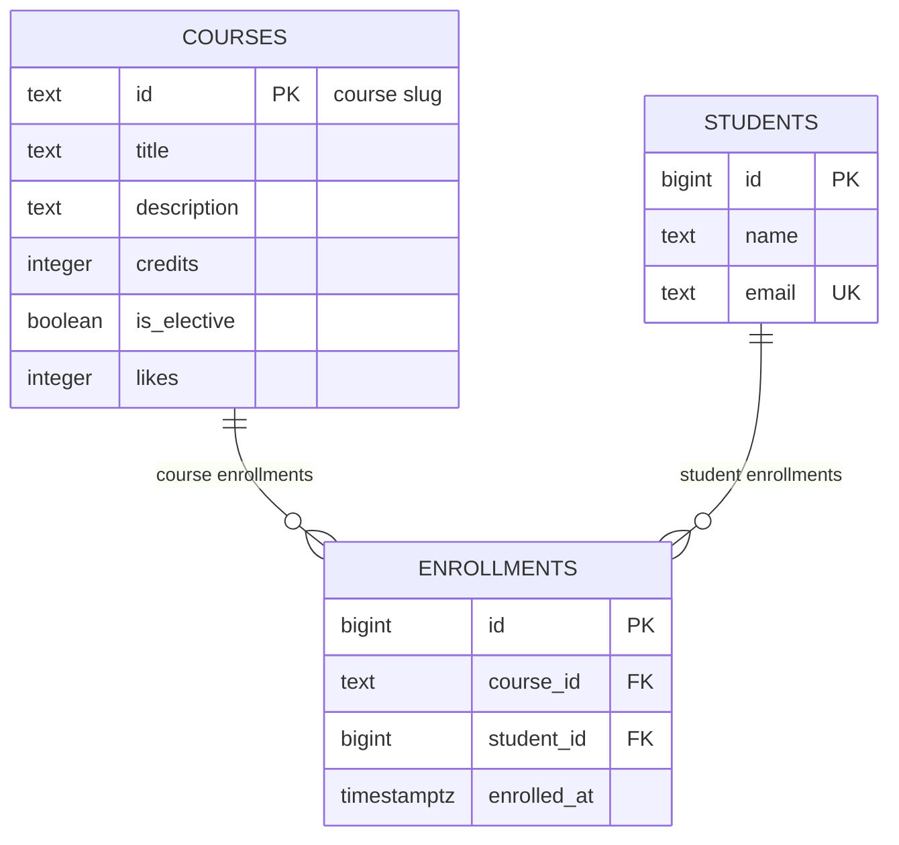

# course-catalog-db

PostgreSQL schema for the course catalog (Lab 6, "Advanced Web Technologies").

## How to run

PostgreSQL 16 or newer is required.

Once, as the `postgres` superuser:

```sql
CREATE ROLE catalog_app LOGIN PASSWORD 'change-me';
CREATE DATABASE course_catalog OWNER catalog_app;
CREATE DATABASE idx_demo       OWNER catalog_app;
CREATE DATABASE norm_demo      OWNER catalog_app;
```

Then, from the project folder (stops at the first error):

```bash
psql -h localhost -U catalog_app -d course_catalog -v ON_ERROR_STOP=1 -f schema.sql
psql -h localhost -U catalog_app -d course_catalog -v ON_ERROR_STOP=1 -f seed.sql
psql -h localhost -U catalog_app -d course_catalog -v ON_ERROR_STOP=1 -f queries.sql
```

The password `change-me` is for teaching; real projects keep passwords out of git.

---

## Schema



The catalog has three tables. `courses` and `students` hold independent entities; `enrollments` is the join table that models the many-to-many relationship between them — one student can enroll in many courses, and one course can have many students.

---

## Design decisions

- `courses.id` is a text slug (e.g. `modern-frontend`) because the slug is already a stable, human-readable identifier used in URLs; a surrogate numeric key would add no value. `students.id` is an auto-generated `bigint` because students have no natural unique key — the email is unique but can change, and a number is cheaper to reference in a foreign key.

- `ON DELETE RESTRICT` on `enrollments.course_id` prevents silently losing enrollment history when a course is removed; a course with enrolled students must be handled explicitly (unenroll students first or archive the course). `ON DELETE CASCADE` on `enrollments.student_id` is the correct choice for a "belongs to" relationship: when an account is deleted, all its enrollments are meaningless and should disappear automatically.

- `timestamptz` (timestamp with time zone) stores the absolute moment of enrollment regardless of server timezone; plain `timestamp` would silently discard zone information and cause bugs if the server is ever moved. `text` is preferred over `varchar(n)` in PostgreSQL because there is no performance difference, and picking an arbitrary length limit (255, 100) creates artificial constraints that require migrations to change.

---

## Constraint violation log

Commands were run with `\set VERBOSITY verbose`.

| # | What we violate | SQLSTATE | Constraint | API response |
|---|-----------------|----------|------------|--------------|
| 1 | NULL in `courses.title` | 23502 | no name — column `title` (NOT NULL) | 422 Unprocessable Entity |
| 2 | `courses.credits = 0` | 23514 | `courses_credits_check` | 422 Unprocessable Entity |
| 3 | `courses.likes = -1` | 23514 | `courses_likes_check` | 500 Internal Server Error (bug in code) |
| 4 | a one-letter student name | 23514 | `students_name_check` | 422 Unprocessable Entity |
| 5 | a duplicate student email | 23505 | `students_email_key` | 409 Conflict |
| 6 | a duplicate course id | 23505 | `courses_pkey` | 409 Conflict |
| 7 | a repeated enrollment in a course | 23505 | `enrollments_course_id_student_id_key` | 409 Conflict |
| 8 | enrolling in a nonexistent course | 23503 | `enrollments_course_id_fkey` | 404 Not Found |
| 9 | enrolling a nonexistent student | 23503 | `enrollments_student_id_fkey` | 404 Not Found |
| 10 | deleting a course that has enrollments | 23001 (PG 18) / 23503 (PG 16-17) | `enrollments_course_id_fkey` | 409 Conflict |
| 11 | deleting a student (CASCADE check) | — no error — | ON DELETE CASCADE | enrollments deleted automatically: 6 → 3, back to 6 after ROLLBACK |

**Why check in the database if Pydantic already validates?**  
Pydantic guards one entry point — the HTTP API. The database is often accessed by other clients too: migration scripts, admin tools, direct `psql` sessions, future microservices. A constraint in the schema is enforced for every writer, not just the one that goes through your FastAPI code. The two layers serve different purposes: Pydantic gives a friendly 422 with field-level detail; the database constraint is the last line of defence that prevents corrupt data from ever being stored.

---

## Index: EXPLAIN before and after

Query: `SELECT * FROM enrollments WHERE student_id = 777;`

Database `idx_demo`: 500 courses, 20,000 students, 50,000 enrollments.

|  | Before the index | After the index |
|---|------------------|-----------------|
| Access method | Seq Scan | Bitmap Heap Scan → Bitmap Index Scan |
| cost | 0.00..1042.00 | 4.31..15.59 |
| Rows Removed by Filter | 49,997 | 0 (index goes straight to the rows) |
| Execution Time | ~3.6 ms | ~0.05 ms |

**Before:**

```
Seq Scan on enrollments  (cost=0.00..1042.00 rows=3 width=34)
  Filter: (student_id = 777)
```

**After:**

```
Bitmap Heap Scan on enrollments  (cost=4.31..15.59 rows=3 width=34)
  Recheck Cond: (student_id = 777)
  ->  Bitmap Index Scan on enrollments_student_id_idx  (cost=0.00..4.31 rows=3 width=0)
        Index Cond: (student_id = 777)
```

**Answers:**

1. PostgreSQL automatically creates indexes for `PRIMARY KEY` and `UNIQUE` constraints. `enrollments.student_id` is a `FOREIGN KEY` — PostgreSQL deliberately does not auto-index foreign keys, because not every FK column is queried frequently, and indexes have a write-time cost. `email` got an index from its `UNIQUE` constraint; `course_id` got one from the unique pair `(course_id, student_id)`, which also covers searches on the leading column.

2. The query planner compares estimated costs. For the six-row `courses` table the entire table fits on a single data page; reading that one page (cost ≈ 1) is cheaper than the overhead of an index lookup (page read + index page read). For the 50,000-row `enrollments` table a sequential scan costs ≈ 1042 vs ≈ 15 through the index, so the index wins.

3. The index on `student_id` speeds up: (a) `SELECT * FROM enrollments WHERE student_id = ?` — the query that lists one student's enrollments (route `GET /enrollments` filtered by student); (b) the cascade delete — when `DELETE FROM students WHERE id = ?` fires, PostgreSQL must find and delete all matching rows in `enrollments`; without the index it scans the whole table for every student deletion.

---

## Transaction

**Scenario:** enroll a new student in a course — two inserts in one transaction.

**The second insert failed:** after inserting the student successfully, the second `INSERT INTO enrollments` referenced a nonexistent course (`no-such-course`), which violated `enrollments_course_id_fkey`. PostgreSQL immediately aborted the transaction (prompt changed from `=*>` to `=!>`). Every subsequent command — even a plain `SELECT` — was rejected with "current transaction is aborted, commands ignored until end of transaction block". After `ROLLBACK`, the student row was also gone (`count = 0`): both inserts were rolled back together, leaving no orphaned student in the database.

**Window B saw** `count = 0` before `COMMIT` (the rows were invisible to other sessions while the transaction was open) and `count = 1` after `COMMIT` (both rows appeared atomically at the same instant).

**Without a transaction**, if the second insert had failed after the first succeeded, the database would have been left with a student who has no enrollment — a "half-operation" with no way to clean it up automatically. Transactions guarantee atomicity: either everything is applied or nothing is.

*In week 7, a SQLAlchemy session will open a transaction automatically, and the route handler will call `commit()` on success or let the exception trigger a `rollback()`.*

---

## Self-review against the checklist

| What to check | Result |
|---------------|--------|
| Keys | Yes — every table has a primary key; foreign keys exist for both relationships (`enrollments.course_id → courses`, `enrollments.student_id → students`). |
| Types | Yes — `credits` and `likes` are `integer`; timestamps use `timestamptz`; text identifiers use `text`; auto-increment keys use `bigint GENERATED ALWAYS AS IDENTITY`. |
| Required values | Yes — all columns that must always have a value are `NOT NULL`; only `is_elective` (default `false`) and `likes` (default `0`) have defaults that substitute for a missing value. |
| Constraints | Yes — domain rules are `CHECK (credits > 0)`, `CHECK (likes >= 0)`, `CHECK (length(name) >= 2)`, `UNIQUE (email)`, `UNIQUE (course_id, student_id)`; consistent with Pydantic's `Field(min_length=2)`. |
| Deletion | Yes — `RESTRICT` on `course_id` (a course with enrollments must be handled explicitly) and `CASCADE` on `student_id` (enrollments belong to the student and die with them) were chosen deliberately. |
| Normalization | Yes — no fact is stored in more than one place; every non-key attribute depends only on its table's primary key; there are no comma-separated lists in any cell. |
| Indexes and names | Yes — `enrollments_student_id_idx` covers the FK not auto-indexed by PostgreSQL; the UNIQUE constraints on `email` and `(course_id, student_id)` produce their own indexes; names follow `snake_case` throughout and use the table-name prefix convention (`course_id`, not `cid`). |
